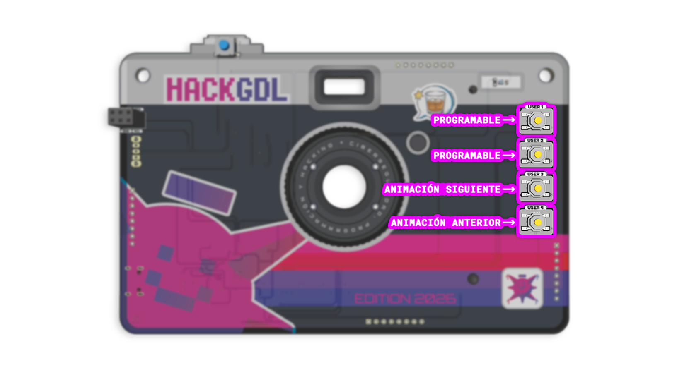
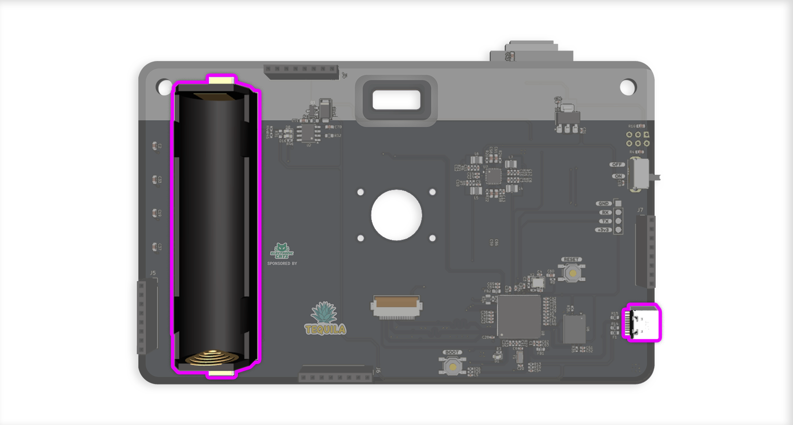
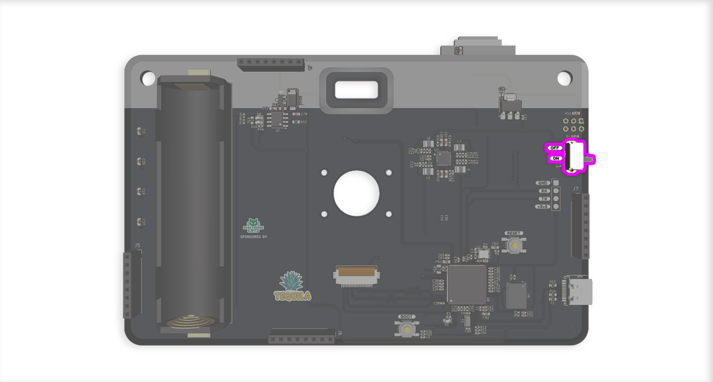
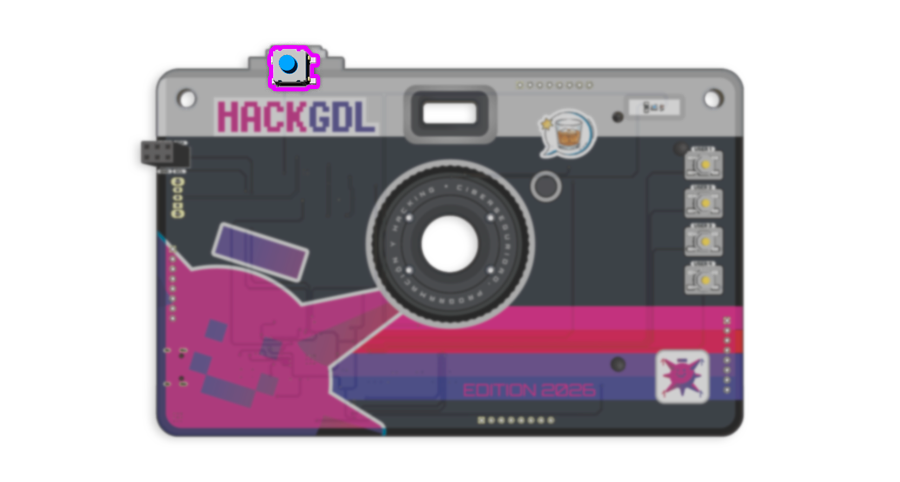
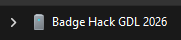
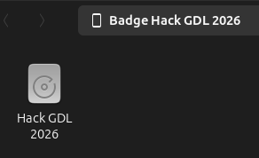
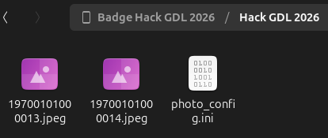
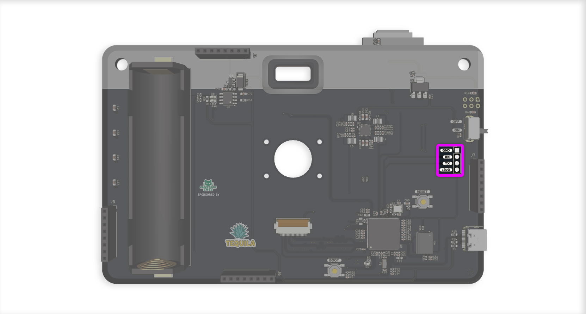

# Badge Hack GDL 2026

El Badge Hack GDL 2025 es un dispositivo de hardware abierto diseñado para la comunidad de hackers, desarrolladores y entusiastas de la tecnología. Cuenta con un potente procesador Linux capaz de ejecutar aplicaciones personalizadas, junto con una amplia variedad de interfaces para ampliar su funcionalidad.

## 🚀 Características Principales

### Procesador principal 
- **RV1106**: Procesador Linux de alto rendimiento
  - ARM Cortex-A7 + MCU RISC-V
  - NPU integrada (Unidad de Procesamiento Neural)
  - ISP integrado (Procesador de Señal de Imagen)
  - Soporte completo para sistemas operativos Linux

### Interfaces y Conectividad
- **GPIOs**: Múltiples pines de propósito general
- **MIPI CSI**: Interfaz para cámaras y sensores de imagen
- **UART**: Comunicación serial asíncrona
- **USB**: Puerto USB con hub integrado

### Periféricos Integrados
- **Neopixels**: LEDs RGB programables WS2812E
- **Batería**: Soporte para baterías 18650 con gestión de energía
- **Buck Converter**: Regulación eficiente DC-DC
- **Camara**: Camara SC3336 de 3MP

## 📦 Componentes del Proyecto

El proyecto está dividido en dos directorios principales:

### 1. Badge Principal (`hardware/`)
Incluye el diseño principal:
- Procesador RV1106G3
- LEDs Neopixel WS2812E
- Gestión de energía y batería
- Interface MIPI para camara

## 📋 Especificaciones Técnicas

| Componente | Especificación |
|------------|----------------|
| Procesador | RV1106G3 (ARM Cortex-A7 + RISC-V MCU + NPU + ISP) |
| Sistema Operativo | Linux |
| LEDs | WS2812E Neopixels |
| Batería | Soporte 18650 |
| Interfaces | USB, MIPI CSI, Botones |


## 🔌 Interfaces del RV1106

El procesador RV1106 ofrece las siguientes interfaces:

### Comunicación
- **UART**: Comunicación serial (debug/terminal)
- **SPI**: Interfaz periférica de alta velocidad
- **I2C**: Para sensores, pantallas y otros dispositivos I2C
- **USB**: Hub USB integrado

### Multimedia e Imagen
- **MIPI CSI**: Interfaz para cámaras y sensores de imagen
- **ISP**: Procesador de señal de imagen integrado

### Control
- **GPIOs**: Pines de propósito general
- **PWM**: Canales PWM para control de LEDs y motores
***
### **Primeros pasos**

El **Badge Hack GDL 2026** está basado en el hardware y el SDK de la Luckfox Pico Pro Max. Para información técnica adicional sobre la plataforma, puedes consultar la Wiki oficial de Luckfox.

El badge integra el **RV1106G3**, un microprocesador de bajo consumo de Rockchip que combina una CPU ARM con un coprocesador RISC-V de 32 bits, optimizado para aplicaciones de procesamiento y codificación/decodificación de audio y video.

En esta sección aprenderás cómo:
- Encender y utilizar tu badge
- Tomar fotografías
- Extraer las imágenes a tu computadora
- Personalizar los elementos visuales (OSD) de las fotos
***
### **Blink Blink!**
Presiona los botones USER 3 y USER 4 que se encuentran al frente del badge y miras las animaciones del led rgb que preparamos para ti!!


***
### **📸 Tomar fotografías**
1. **Alimentar tu badge**

Antes de usarlo, asegúrate de que el badge esté correctamente alimentado. Puedes hacerlo de dos maneras:
- Conectando una batería compatible
- Conectándolo mediante USB a una fuente que pueda suministrar energía


***
2. **Encender el badge**

El badge cuenta con un interruptor físico de encendido/apagado.
- Coloca el switch en la posición **ON**.
- Una vez encendido, el sistema iniciará automáticamente.

Como confirmación visual de que el dispositivo arrancó correctamente, al iniciar verás una **secuencia de parpadeo de color verde** en el NeoPixel: dos parpadeos de 1 segundo cada uno (500 ms encendido + 500 ms apagado). Después de esa secuencia, el LED entra a la rutina de animación normal.


***
3. **Tomar una fotografía**

Con el badge encendido, presiona el botón superior para capturar una fotografía.

Cada imagen se guarda automáticamente en la memoria interna del dispositivo.

Al presionar el botón de captura (`KEY_ENTER`), el NeoPixel ejecuta un **parpadeo de confirmación en color blanco**: dos parpadeos rápidos de 500 ms cada uno (250 ms encendido + 250 ms apagado). Este indicador se ejecuta aunque haya otra rutina en curso e interrumpe brevemente la animación actual; al terminar, la rutina continúa como antes.


***
### **💾 Extraer fotografías**

Las imágenes se transfieren mediante **MTP (Media Transfer Protocol)**, por lo que el badge se comporta como un dispositivo multimedia (similar a un teléfono en modo transferencia de archivos).

1. **Conectar el badge**

Conecta el badge a tu computadora utilizando un cable USB con capacidad de transmisión de datos.

Tanto **Windows** como **Linux** cuentan con soporte nativo para MTP.
***
2. **Identificar el dispositivo**

Al conectarlo, aparecerá un nuevo dispositivo llamado:
```
Hack GDL 2026
```
**Ubuntu**


**Windows**



Ábrelo como si fuera un teléfono conectado en modo transferencia de archivos.
***
3. **Acceder y extraer las imágenes**

Dentro del dispositivo encontrarás un almacenamiento llamado:
```
Hack GDL 2026
```

**Screenshot de Ubuntu**



Al acceder, podrás ver:
- Las fotografías capturadas
- Un archivo llamado `photo_config.ini`

Desde aquí puedes:
- Copiar las imágenes a tu computadora
- Eliminar fotografías si lo deseas

**Screenshot de Ubuntu**


***
### **⚙ Archivo `photo_config.ini`**

El archivo `photo_config.ini` define la configuración de los **OSD (On-Screen Display)** que se muestran al momento de capturar una fotografía.

Un ejemplo de configuración es el siguiente:
```
[osd.2]
type = character
enabled = 1
position_x = 100
position_y = 100
display_text = Hack GDL 2026

[osd.6]
type = image
enabled = 1
position_x = 100
position_y = 640
image_path = /root/electroniccats.bmp

[osd.7]
type = image
enabled = 1
position_x = 1520
position_y = 640
image_path = /root/hack_gdl.bmp
```
***
### **🖼 ¿Qué es un OSD?**

OSD significa **On-Screen Display** (Visualización en Pantalla).
Son elementos gráficos o de texto que se superponen sobre la imagen antes de guardarse.

En este proyecto, los OSD permiten agregar:
- Texto personalizado
- Logos
- Imágenes decorativas

directamente sobre la fotografía capturada.
***
### **🔎 Explicación del ejemplo**
`[osd.2]` – **Texto personalizado**
```
type = character
```
Indica que el OSD es texto.
```
enabled = 1
```
Activa el OSD (0 lo desactiva).
```
position_x = 100
position_y = 100
```
Define la posición del texto en la imagen (coordenadas X,Y).
```
display_text = Hack GDL 2026
```
Texto que aparecerá sobre la fotografía.
***
`[osd.6]` y `[osd.7]` – **Imágenes superpuestas**
```
type = image
```
Indica que el OSD es una imagen.
```
image_path = /root/electroniccats.bmp
```
Ruta de la imagen que se superpondrá.
```
position_x / position_y
```
Definen la ubicación dentro de la fotografía.

En el ejemplo:
- Se coloca el logo electroniccats.bmp en la parte inferior izquierda.
- Se coloca el logo hack_gdl.bmp en la parte inferior derecha.
***
### **🎨 Personalización**

Puedes modificar:
- El texto mostrado
- Las posiciones
- Activar o desactivar elementos
- Cambiar las imágenes por otras compatibles

Después de modificar el archivo y guardar los cambios, las siguientes fotografías usarán la nueva configuración.
***
# **🚀 ¿Te interesa saber más sobre cómo se programó todo esto?**

Si tienes curiosidad por conocer cómo funciona el badge internamente, estás en el lugar correcto.

A partir de aquí podrás descubrir cómo se construyó el sistema, cómo se integraron los servicios y cómo funciona la captura de imágenes y la configuración de los OSD.

Esta sección es ideal si quieres:
- Aprender a construir tu propia imagen del sistema
- Entender cómo comunicarte con tu badge (ADB, MTP, consola)
- Compilar y agregar tus propios scripts o servicios
- Agregar soporte para más OSD
- Comprender cómo se configuraron los botones
- Entender cómo se integró y programó el NeoPixel
- Modificar y mejorar el comportamiento actual

Si te interesa experimentar, personalizar y llevar el badge al siguiente nivel, sigue leyendo.
***
## 🔌 Conectarse al puerto serial (Debug Serial)
Para interactuar con el badge (ejecutar comandos, ver logs o depurar), debes conectarte al puerto DEBUG SERIAL mostrado en la imagen anterior.
Este puerto corresponde a la UART2 del RV1106:



```
TX → GPIO1_B2_D
RX → GPIO1_B3_U
```
⚠ Importante: La señal del puerto serial del badge es 3.3V TTL.

## ✔ Adaptadores USB–Serial compatibles

Puedes usar cualquier adaptador USB a UART de 3.3V, por ejemplo:

CH340 / CH341
CP2102 / CP2104
FT232RL
PL2303
CP2105

Matek F405 adapters (soportan 3.3V)

Asegúrate de:
```
TX del adaptador → RX del badge
RX del adaptador → TX del badge
GND → GND
```
[IMAGEN MMALONA DE LA PLACA DONDE SE VEN LOS PINES UART]
## 💻 Cómo abrir la terminal serial

A continuación, cómo conectarte desde Linux, macOS y Windows.

## 🐧 Linux

Conecta el adaptador USB-serial.

Verifica qué puerto creó:
```
dmesg | grep tty
```

Normalmente aparecerá como:
```
/dev/ttyUSB0
/dev/ttyACM0
```
Conéctate con screen o minicom:

Con screen (lo más fácil)
```
screen /dev/ttyUSB0 115200
```

Para salir:
CTRL + A luego K (y confirma).

Con minicom
```
sudo minicom -b 115200 -D /dev/ttyUSB0
```

## 🍎 macOS

Conecta el adaptador USB-UART.

Ver puertos disponibles:
```
ls /dev/tty.*
```

Suelen ser:
```
/dev/tty.usbserial-*
/dev/tty.wchusbserial*
/dev/tty.SLAB_USBtoUART
```

Conéctate:

```
screen /dev/tty.usbserial-XXXX 115200
```

Para salir:
CTRL + A, luego K.

Mac también permite usar CoolTerm (GUI amigable).

## 🪟 Windows

Usa un cliente serial como:
```
PuTTY
TeraTerm
CoolTerm
RealTerm
```

Conecta el adaptador USB-UART.

Abre el Administrador de dispositivos → “Puertos (COM y LPT)”

Identifica el puerto COM, ejemplo: COM4

Abre PuTTY o TeraTerm y selecciona:
```
Port: COM4
Baudrate: 115200
Data bits: 8
Parity: None
Stop bits: 1
Flow control: None
```
Con eso verás la consola del badge.
***
### **Comunicación ADB en Luckfox Pico Pro Max**

La **comunicación ADB (Android Debug Bridge)** está habilitada por defecto en la placa, lo que permite ejecutar comandos, explorar archivos y depurar directamente desde un computador.

**Cómo conectarse**
1. Conecta la placa al computador mediante USB.
2. Abre una terminal y ejecuta:
```
adb devices
```
Deberías ver la placa listada como un dispositivo conectado.
3. Para acceder al shell de la placa:
```
adb shell
```
**Descargar ADB**

ADB forma parte de las **Android Platform Tools** y se puede descargar desde la página oficial:

https://developer.android.com/studio/releases/platform-tools

En Linux también se puede instalar directamente con:
```
sudo apt update
sudo apt install android-tools-adb
```
***
### **Acceso:**<br>
Para acceder al dispositivo los accesos son:<br>
**usuario:** ***root***<br>
**password:** ***contrasenia***
***
### **Configuración de Luckfox SDK**

Antes de comenzar, es necesario que descargues el **fork del repositorio de Luckfox SDK** que preparamos para construir la imagen de nuestro *Badge Hack GDL 2026*.

⚠️ Asegúrate de clonar la rama `badge_hackgdl_2026`.
```
git clone -b badge_hackgdl_2026 --single-branch https://github.com/ElectronicCats/luckfox-pico.git
```

Para configurar y habilitar el módulo SPI y los pines gpio es necesario activarlos desde la configuración del DTS dentro del SDK de la placa Luckfox Pico.<br>
Antes de modificar el DTS, primero debemos configurar el SDK. Desde el directorio raíz del proyecto luckfox-sdk, ejecuta:
```
./build.sh lunch
```
Aparecerá el siguiente menú para seleccionar la versión de hardware:
```
You're building on Linux
  Lunch menu...pick the Luckfox Pico hardware version:
  选择 Luckfox Pico 硬件版本:
                [0] RV1103_Luckfox_Pico
                [1] RV1103_Luckfox_Pico_Mini
                [2] RV1103_Luckfox_Pico_Plus
                [3] RV1103_Luckfox_Pico_WebBee
                [4] RV1106_Luckfox_Pico_Pro_Max
                [5] RV1106_Luckfox_Pico_Ultra
                [6] RV1106_Luckfox_Pico_Ultra_W
                [7] RV1106_Luckfox_Pico_Pi
                [8] RV1106_Luckfox_Pico_Pi_W
                [9] RV1106_Luckfox_Pico_86Panel
                [10] RV1106_Luckfox_Pico_86Panel_W
                [11] RV1106_Luckfox_Pico_Zero
                [12] custom
Which would you like? [0~12][default:0]:
```
En nuestro caso, debemos seleccionar la opción:
```
4
```
Esta opción corresponde a la placa **RV1106_Luckfox_Pico_Pro_Max**, que es la base de nuestro **Badge Hack GDL 2026**.
***
### **Selección del medio de arranque** <br>
A continuación, el sistema solicitará seleccionar el medio de arranque:
```
  Lunch menu...pick the boot medium:
  选择启动媒介:
                [0] SD_CARD
                [1] SPI_NAND
Which would you like? [0~1][default:0]:
```
Debemos seleccionar:
```
1
```
Esto indica que utilizaremos **SPI NAND** como medio de booteo.
***
### **Selección del sistema**

Finalmente, se debe seleccionar la versión del sistema:

```
  Lunch menu...pick the system version:
  选择系统版本:
                [0] Buildroot 
Which would you like? [0][default:0]:
```
En nuestro caso, solo contamos con:
```
0
```
Es decir, utilizaremos **Buildroot**
***
### **Primera compilación**

Una vez completada la configuración de la placa, es necesario realizar la primera compilación de la imagen ejecutando:
```
./build.sh
```
Este proceso puede tardar varios minutos. Al finalizar, el proyecto quedará preparado para continuar con la configuración.
***
⚠️ Si clonaste correctamente la rama `badge_hackgdl_2026`, puedes omitir los siguientes pasos o revisarlos únicamente como referencia para entender qué modificaciones se realizaron.
***
### **Configuración del DTS**
Después de la primera compilación, en el directorio raíz del proyecto se habrá generado un nuevo directorio llamado:
```
config/
```
Dentro de este directorio se crean enlaces simbólicos hacia los archivos de configuración de la placa. El archivo que nos interesa es:
```
dts_config
```
***
### **Activación del SPI en el DTS**
En el archivo dts_config debemos localizar la configuración correspondiente a `spi0` y cambiar su propiedad `status` de:
```
status = "disabled";
```
a:
```
status = "okay";
```
La configuración final debe verse de la siguiente manera:
```
/**********SPI**********/
&spi0 {
	status = "okay";
	spidev@0 {
		spi-max-frequency = <50000000>;
	};
	fbtft@0 {
		spi-max-frequency = <50000000>;
	};
};
```
Con esto, el módulo `spi0` quedará habilitado correctamente en el sistema.
***
### **Configuración de botones en el Device Tree (DTS)**
En nuestro **Badge Hack GDL 2026**, los botones físicos se configuran en el **Device Tree** para que el kernel los reconozca como **teclado GPIO**. Esto permite leerlos como **eventos de entrada** (`input`), por ejemplo desde `/dev/input/eventX`.
### **1. Definición de los botones (`gpio-keys`)**
Dentro del árbol raíz del DTS (`/ { ... }`) se define un nodo `gpio_keys` que contiene todos los botones:
```
gpio_keys: gpio-keys {
    compatible = "gpio-keys";
    pinctrl-names = "default";
    pinctrl-0 = <&gpio1_pd3
                 &gpio2_pb1
                 &gpio2_pb0
                 &gpio2_pa7
                 &gpio2_pa6>;

    key_user: key-user {
        label = "USER_KEY";
        linux,code = <KEY_ENTER>;
        gpios = <&gpio1 RK_PD3 GPIO_ACTIVE_LOW>;
        debounce-interval = <10>;
        wakeup-source;
    };
    key__user_up: key-user-up {
        label = "UP_USER_KEY";
        linux,code = <KEY_UP>;
        gpios = <&gpio2 RK_PB1 GPIO_ACTIVE_LOW>;
        debounce-interval = <10>;
        wakeup-source;
    };
    key_user_right: key-user-right {
        label = "RIGHT_USER_KEY";
        linux,code = <KEY_RIGHT>;
        gpios = <&gpio2 RK_PB0 GPIO_ACTIVE_LOW>;
        debounce-interval = <10>;
        wakeup-source;
    };
    key_user_left: key-user-left {
        label = "LEFT_USER_KEY";
        linux,code = <KEY_LEFT>;
        gpios = <&gpio2 RK_PA7 GPIO_ACTIVE_LOW>;
        debounce-interval = <10>;
        wakeup-source;
    };
    key_user_down: key-user-down {
        label = "DOWN_USER_KEY";
        linux,code = <KEY_DOWN>;
        gpios = <&gpio2 RK_PA6 GPIO_ACTIVE_LOW>;
        debounce-interval = <10>;
        wakeup-source;
    };
};
```
### **Explicación:**
- `compatible = "gpio-keys"` → define que los GPIO se usarán como teclado genérico.
- `pinctrl-0` → referencia a los pines que se configuran más abajo.
- Cada nodo `key_*` define un botón:
    - `label` → nombre descriptivo
    - `linux,code` → código de tecla asignado por Linux (KEY_ENTER, KEY_UP, etc.)
    - `gpios` → pin físico y lógica (GPIO_ACTIVE_LOW)
    - `debounce-interval` → tiempo para filtrar rebotes del botón
    - `wakeup-source` → permite que el botón despierte la placa en suspensión
Gracias a esta configuración, cada botón se expone como **evento de tipo input**, listo para ser leído desde programas C o Python.
***
### **2. Configuración de pines GPIO**
Los pines que controlan los botones se definen en `&pinctrl` fuera del nodo raíz:
```
/**********GPIO*********/
&pinctrl {
    gpio1-pd3 {
        gpio1_pd3: gpio1-pd3 {
            rockchip,pins = <1 RK_PD3 RK_FUNC_GPIO &pcfg_pull_up>;
        };
    };
    gpio2-pb1 {
        gpio2_pb1: gpio2-pb1 {
            rockchip,pins = <2 RK_PB1 RK_FUNC_GPIO &pcfg_pull_up>;
        };
    };
    gpio2-pb0 {
        gpio2_pb0: gpio2-pb0 {
            rockchip,pins = <2 RK_PB0 RK_FUNC_GPIO &pcfg_pull_up>;
        };
    };
    gpio2-pa7 {
        gpio2_pa7: gpio2_pa7 {
            rockchip,pins = <2 RK_PA7 RK_FUNC_GPIO &pcfg_pull_up>;
        };
    };
    gpio2-pa6 {
        gpio2_pa6: gpio2_pa6 {
            rockchip,pins = <2 RK_PA6 RK_FUNC_GPIO &pcfg_pull_up>;
        };
    };
};
```
### **Explicación:**
- Cada pin se configura como **GPIO con pull-up interno**, garantizando señales estables.
- `rockchip,pins` → indica banco, pin y función (GPIO).
- Esto asegura que los botones funcionen correctamente y puedan ser detectados como entradas digitales.
***
### **3. Resultado final**
Con esta configuración:
- Los botones son detectados como **teclado GPIO**, accesibles vía `/dev/input/eventX`.
- Se pueden usar en programas C o Python para cambiar modos, activar funciones o interactuar con LEDs.
- Permite integrar la lectura de botones en **hilos separados**, evitando bloquear otros procesos (por ejemplo el control de LEDs WS2812B).

Para nuestro **Badge Hack GDL 2026**, se han configurado **5 botones** con diferentes funciones:
- Uno de ellos se utiliza para tomar fotografías.
- Dos botones sirven para cambiar el modo del LED Neopixel.
- Los dos botones restantes se dejaron disponibles para el usuario.

¡Así que adelante! Puedes usar estos botones para desarrollar tus propios programas, ya sea en C o Python, y crear tus propios efectos o funcionalidades personalizadas.
***
### **NEOPIXELES**
El LED RGB WS2812B (mejor conocido como NeoPixel) pueden controlarse utilizando el módulo de spidev a través de la interfaz SPI del RV1106.
Es importante destacar que SPI se utiliza como un generador de trenes de pulsos a 800 kHz, lo cual es necesario para el funcionamiento correcto de los NeoPixel.
### **Control de LEDs WS2812B mediante SPI en C**
Una vez habilitado el módulo SPI y generado el sistema con Buildroot, el siguiente paso es crear una aplicación en C que controle los LEDs WS2812B utilizando la interfaz `/dev/spidev0.0`.

**Código completo:**
```
#include <stdio.h>
#include <stdlib.h>
#include <stdint.h>
#include <unistd.h>
#include <fcntl.h>
#include <string.h>
#include <math.h>
#include <pthread.h>
#include <signal.h>
#include <linux/spi/spidev.h>
#include <linux/input.h>
#include <sys/ioctl.h>
#include <errno.h>
#include <time.h>
#define SPI_DEVICE_PATH "/dev/spidev0.0"
#define SPI_SPEED 2400000
#define NUM_LEDS 1
#define NUM_MODES 5
#define EVENT_DEVICE "/dev/input/event1"

static volatile int running = 1;
static volatile sig_atomic_t blink_request = 0;

typedef struct {
    int current_mode;
    pthread_mutex_t lock;
} controller_state_t;

controller_state_t state;

void next_mode() {
    pthread_mutex_lock(&state.lock);
    state.current_mode = (state.current_mode + 1) % NUM_MODES;
    printf("[MODE] -> %d\n", state.current_mode);
    pthread_mutex_unlock(&state.lock);
}

void prev_mode() {
    pthread_mutex_lock(&state.lock);
    state.current_mode = (state.current_mode - 1 + NUM_MODES) % NUM_MODES;
    printf("[MODE] -> %d\n", state.current_mode);
    pthread_mutex_unlock(&state.lock);
}

int get_mode() {
    int mode;
    pthread_mutex_lock(&state.lock);
    mode = state.current_mode;
    pthread_mutex_unlock(&state.lock);
    return mode;
}

void byte_to_spi(uint8_t byte, uint8_t *out, int *idx) {
    for (int i = 0; i < 8; i++) {
        if (byte & (1 << (7 - i)))
            out[(*idx)++] = 0b1110;
        else
            out[(*idx)++] = 0b1000;
    }
}

void color_to_spi(uint8_t r, uint8_t g, uint8_t b, uint8_t *out, int *idx) {
    byte_to_spi(g, out, idx);
    byte_to_spi(r, out, idx);
    byte_to_spi(b, out, idx);
}

void color_blink(int fd, uint8_t r, uint8_t g, uint8_t b, int count, int half_period_us) {
    uint8_t buf[NUM_LEDS * 24];
    int len;

    for (int n = 0; n < count; n++) {
        len = 0;
        for (int i = 0; i < NUM_LEDS; i++)
            color_to_spi(r, g, b, buf, &len);
        write(fd, buf, len);
        usleep(half_period_us);

        len = 0;
        for (int i = 0; i < NUM_LEDS; i++)
            color_to_spi(0, 0, 0, buf, &len);
        write(fd, buf, len);
        usleep(half_period_us);
    }
}

void make_frame(int mode, int step, uint8_t *buf, int *len) {
    *len = 0;

    for (int i = 0; i < NUM_LEDS; i++) {
        uint8_t r = 0, g = 0, b = 0;

        switch (mode) {
            case 0:
                break;

            case 1: {
                double angle = (step % 100) / 100.0 * 2 * M_PI;
                double brightness = (sin(angle) + 1.0) / 2.0;
                r = (uint8_t)(255 * brightness);
                b = (uint8_t)(255 * brightness);
                break;
            }

            case 2:
                if (i == (step % NUM_LEDS)) b = 255;
                else b = 10;
                break;

            case 3:
                if ((i + step) % 3 == 0) {
                    r = g = b = 255;
                } else {
                    r = 50;
                }
                break;

            case 4: {
                int pos = ((i * 256 / NUM_LEDS) + step) & 255;
                if (pos < 85) {
                    r = pos * 3;
                    g = 255 - pos * 3;
                } else if (pos < 170) {
                    pos -= 85;
                    r = 255 - pos * 3;
                    b = pos * 3;
                } else {
                    pos -= 170;
                    g = pos * 3;
                    b = 255 - pos * 3;
                }
                break;
            }
        }

        color_to_spi(r, g, b, buf, len);
    }
}

void *led_thread(void *arg) {
    int fd = open(SPI_DEVICE_PATH, O_WRONLY);
    if (fd < 0) {
        printf("SPI open\n");
        return NULL;
    }

    uint8_t mode = SPI_MODE_0;
    uint8_t bits = 8;

    ioctl(fd, SPI_IOC_WR_MODE, &mode);
    ioctl(fd, SPI_IOC_WR_BITS_PER_WORD, &bits);
    ioctl(fd, SPI_IOC_WR_MAX_SPEED_HZ, &(uint32_t){SPI_SPEED});

    uint8_t buffer[NUM_LEDS * 24];
    int len;
    int step = 0;

    color_blink(fd, 0, 255, 0, 2, 500000);

    while (running) {
        if (blink_request) {
            blink_request = 0;
            color_blink(fd, 255, 255, 255, 2, 250000);
        }
        int mode_now = get_mode();
        make_frame(mode_now, step, buffer, &len);
        write(fd, buffer, len);
        step++;
        usleep(50000);
    }

    close(fd);
    return NULL;
}

void *button_thread(void *arg) {
    struct input_event ev;

    while (running) {
        int fd = open(EVENT_DEVICE, O_RDONLY);
        if (fd < 0) {
            sleep(1);
            continue;
        }

        while (running) {
            if (read(fd, &ev, sizeof(ev)) == sizeof(ev)) {
                if (ev.type == EV_KEY && ev.value == 1) {
                    if (ev.code == KEY_LEFT)
                        next_mode();
                    else if (ev.code == KEY_DOWN)
                        prev_mode();
                    else if (ev.code == KEY_ENTER)
                        blink_request = 1;
                }
            }
        }
        close(fd);
    }
    return NULL;
}

void signal_handler(int sig) {
    running = 0;
}

int main() {
    signal(SIGINT, signal_handler);
    signal(SIGTERM, signal_handler);

    pthread_mutex_init(&state.lock, NULL);
    state.current_mode = 0;

    pthread_t t_led, t_btn;
    pthread_create(&t_led, NULL, led_thread, NULL);
    pthread_create(&t_btn, NULL, button_thread, NULL);

    pthread_join(t_led, NULL);
    pthread_join(t_btn, NULL);

    pthread_mutex_destroy(&state.lock);
    return 0;
}
```
**¿Qué hace este programa?**

Este programa:
- Controla LEDs WS2812B utilizando SPI
- Genera distintos efectos de iluminación (5 modos)
- Permite cambiar el modo usando botones físicos
- Ejecuta el control de LEDs y la lectura de botones en hilos separados (multithreading)
- Maneja señales del sistema para finalizar correctamente (CTRL+C)
- Muestra un **indicador verde de arranque** y un **parpadeo blanco al capturar fotografía** (`KEY_ENTER`)

El programa utiliza:
- `/dev/spidev0.0` para transmitir datos a los LEDs
- `/dev/input/event1` para leer eventos de botones
- `pthread` para ejecutar tareas en paralelo
- `ioctl()` para configurar la interfaz SPI
***
### **Explicación paso a paso**
### **1. Definiciones y configuración inicial**
```
#define SPI_DEVICE_PATH "/dev/spidev0.0"
#define SPI_SPEED 2400000
#define NUM_LEDS 1
#define NUM_MODES 5
#define EVENT_DEVICE "/dev/input/event1"
```
Aquí se definen constantes del sistema:
- SPI_DEVICE_PATH → dispositivo SPI utilizado
- SPI_SPEED → velocidad del bus SPI (2.4 MHz)
- NUM_LEDS → número de LEDs en la cadena
- NUM_MODES → cantidad de efectos disponibles
- EVENT_DEVICE → dispositivo de entrada para los botones
***
### **2. Estado global y control de hilos**
```
static volatile int running = 1;
```
Variable global que controla la ejecución del programa.<br>
El modificador `volatile` evita que el compilador optimice su lectura, ya que es compartida entre hilos.

```
static volatile sig_atomic_t blink_request = 0;
```
Bandera compartida entre el hilo de botones y el hilo de LEDs. El hilo de botones la activa (`= 1`) cuando se presiona `KEY_ENTER`, y el hilo de LEDs la consume (`= 0`) para disparar el parpadeo blanco de confirmación.<br>
Se usa `sig_atomic_t` porque su lectura/escritura es atómica, lo que permite señalizar entre hilos sin necesidad de un mutex adicional.

**Estructura del estado del controlador**
```
typedef struct {
    int current_mode;
    pthread_mutex_t lock;
} controller_state_t;
```
Aquí se define:
- current_mode → modo de animación actual
- lock → mutex para evitar condiciones de carrera

El mutex garantiza que dos hilos no modifiquen el modo al mismo tiempo.
***
### **3. Cambio de modos**
Funciones:
```
void next_mode()
void prev_mode()
int get_mode()
```
Estas funciones:
- Bloquean el mutex
- Modifican o leen el modo actual
- Desbloquean el mutex

Esto asegura acceso seguro entre hilos.

El uso de:
```
(state.current_mode + 1) % NUM_MODES;
```
permite que el modo vuelva a 0 cuando llega al máximo.
***
### **4. Codificación de datos para WS2812B**
Los WS2812B no usan SPI directamente.<br>
Se “simula” el protocolo utilizando patrones binarios.<br>
**Conversión de byte**
```
void byte_to_spi(uint8_t byte, uint8_t *out, int *idx)
```
Cada bit del byte se convierte en:
- 0b1110 → representa un “1”
- 0b1000 → representa un “0”

Esto genera la temporización correcta para el LED.<br>
Cada byte RGB se convierte en 8 bytes SPI.
***
**Conversión de color**
```
void color_to_spi(uint8_t r, uint8_t g, uint8_t b, ...)
```
Los WS2812B esperan datos en orden:<br>
G → R → B<br>
Por eso primero se envía `g`, luego `r`, luego `b`.
***
### **5. Generación de efectos**
```
void make_frame(int mode, int step, ...)
```
Esta función genera un frame completo de LEDs según el modo actual.

Cada modo hace algo diferente:,<br>
Modo 0 → Apagado<br>
Modo 1 → Efecto respiración usando sin()<br>
Modo 2 → Punto azul en movimiento<br>
Modo 3 → Patrón blanco intermitente<br>
Modo 4 → Rueda de colores tipo arcoíris<br>

El parámetro step permite animación progresiva.<br>
El uso de:
```
double brightness = (sin(angle) + 1.0) / 2.0;
```
genera un efecto suave de encendido/apagado.
***
### **5.1 Parpadeo de indicador (`color_blink`)**
```
void color_blink(int fd, uint8_t r, uint8_t g, uint8_t b, int count, int half_period_us)
```
Función auxiliar que reproduce un parpadeo síncrono del NeoPixel en un color arbitrario. No depende del hilo principal de animación: escribe directamente sobre el `fd` del SPI con `usleep()` entre transiciones, por lo que **bloquea** durante el parpadeo (esto es intencional: queremos un indicador limpio y predecible).

Parámetros:
- `fd` → file descriptor del SPI ya abierto
- `r, g, b` → color del parpadeo
- `count` → cuántas veces parpadear
- `half_period_us` → duración (en microsegundos) de cada semiciclo (encendido y apagado)

Cada llamada produce `count` ciclos de la forma: encendido `half_period_us` → apagado `half_period_us`. Esta función se reutiliza para los dos indicadores del sistema:
- **Indicador de arranque**: `color_blink(fd, 0, 255, 0, 2, 500000)` → 2 parpadeos verdes de 1 s cada uno
- **Indicador de captura**: `color_blink(fd, 255, 255, 255, 2, 250000)` → 2 parpadeos blancos de 0.5 s cada uno
***
### **6. Hilo de LEDs**
```
void *led_thread(void *arg)
```
Este hilo:<br>
1. Abre el dispositivo SPI
2. Configura:
    - Modo SPI
    - Bits por palabra
    - Velocidad
3. Ejecuta el **parpadeo verde de arranque** (2 parpadeos de 1 s) como confirmación visual de que el dispositivo se inicializó correctamente:
```
color_blink(fd, 0, 255, 0, 2, 500000);
```
4. Entra en un bucle:
    - Revisa la bandera `blink_request`. Si está activa, la limpia y ejecuta el **parpadeo blanco** (`color_blink(fd, 255, 255, 255, 2, 250000)`) para confirmar la captura de fotografía. Esto interrumpe brevemente la rutina actual durante 1 s y al terminar la animación continúa donde iba.
    - Obtiene el modo actual
    - Genera el frame
    - Lo envía con write()
    - Espera 50 ms

Esto crea la animación continua y permite que los indicadores se muestren sobre cualquier rutina sin necesidad de pausarla manualmente.
***
### **7. Hilo de botones**
```
void *button_thread(void *arg)
```
Este hilo:
- Abre /dev/input/event1
- Lee eventos tipo EV_KEY
- Si se presiona:
    - KEY_LEFT → siguiente modo
    - KEY_DOWN → modo anterior
    - KEY_ENTER → levanta la bandera `blink_request = 1` para que el hilo de LEDs ejecute el parpadeo blanco de confirmación de captura de fotografía

Permite cambiar efectos en tiempo real y notificar al hilo de LEDs eventos puntuales (como la toma de foto) sin acoplar ambos hilos: el hilo de botones solo levanta la bandera y vuelve inmediatamente a escuchar; el hilo de LEDs es quien decide cuándo atender la solicitud.
***
### **8. Manejo de señales**
```
void signal_handler(int sig)
```
Captura:
- SIGINT (Ctrl+C)
- SIGTERM

Cuando ocurre, pone:
```
running = 0;
```
Esto detiene ambos hilos de forma limpia.
***
### **9. Función principal**
```
int main()
```
La función principal:
1. Registra manejadores de señal
2. Inicializa el mutex
3. Crea dos hilos:
    - LED
    - Botones
4. Espera a que terminen (pthread_join)
5. Libera recursos

El programa funciona porque:
- SPI transmite datos continuamente
- Los LEDs reciben un flujo codificado compatible
- Los botones modifican el estado compartido
- El mutex evita conflictos
- Los hilos permiten ejecución paralela
***
### **Servicio NeoPixel: S99neopixel**

Para controlar la tira de LEDs NeoPixel de manera automática, se creó un script de inicio llamado:
```
S99neopixel
```
**¿Por qué S99?**
- El prefijo `S99` indica que se ejecuta casi al final del arranque, después de otros servicios importantes.
- Esto asegura que la aplicación de NeoPixel solo se inicie cuando todos los servicios de base del sistema ya estén activos.
- Si hubiera otros scripts con el mismo número (`S99`), se ejecuta en orden alfabético, manteniendo un orden predecible.
***
**¿Qué hace este script?**
Este script permite ejecutar un **servicio en segundo plano** que controla la tira NeoPixel.
- **DAEMON** → `/usr/bin/neopixel` (el binario que controla los LEDs)
- **PIDFILE** → `/var/run/neopixel.pid` (archivo donde se guarda el ID del proceso)

El script soporta los comandos típicos de un servicio:

| Comando   | Acción |
|-----------|--------|
| start     | Inicia el servicio en segundo plano y crea el PIDFILE |
| stop      | Detiene el servicio si está corriendo y elimina el PIDFILE |
| restart   | Detiene y luego inicia nuevamente el servicio |
| status    | Verifica si el servicio está corriendo y muestra su PID |
**Cómo funciona internamente**
1. **Inicio (`start`)**

    Usa start-stop-daemon para ejecutar el binario NeoPixel en segundo plano, asegurándose de que:
    - Se cree un PID para identificar el proceso
    - No se bloquee la ejecución del resto del sistema

2. **Detención (`stop`)**
    - Revisa el PIDFILE y mata el proceso correspondiente si existe.
    - Elimina el PIDFILE para que no queden registros falsos.
3. **Reinicio (`restart`)**
- Ejecuta primero stop, espera 1 segundo y luego start.
4. **Estado (`status`)**
- Verifica si el PID registrado en el PIDFILE está activo.
- Informa si el servicio está corriendo o detenido.

**Objetivo principal**
- Ejecutar la aplicación NeoPixel como un servicio en Linux embebido.
- Integrarse con System V init para arrancar automáticamente al iniciar el sistema.
- Garantizar que la tira de LEDs siempre esté controlada sin intervención manual del usuario.
### **Compilación cruzada**
Para compilar el programa en C para la placa **Luckfox Pico**, debemos usar la **toolchain de ARM** incluida en el SDK. La herramienta de compilación se encuentra en:
```
luckfox-pico/tools/linux/toolchain/arm-rockchip830-linux-uclibcgnueabihf/bin/arm-rockchip830-linux-uclibcgnueabihf-gcc
```
**Nota:** `luckfox-pico` es el directorio raíz de tu repositorio Luckfox SDK. Ajusta la ruta si tu repositorio está en otra ubicación.
***
### **Makefile simple**
Crea un archivo llamado `Makefile` en el mismo directorio que tu código fuente (`neopixel.c`):
```
# Compilador cruzado ARM del SDK Luckfox
CC := luckfox-pico/tools/linux/toolchain/arm-rockchip830-linux-uclibcgnueabihf/bin/arm-rockchip830-linux-uclibcgnueabihf-gcc

# Target: ejecutable neopixel
neopixel: neopixel.c
	-$(CC) $^ -o $@ -lpthread -lm
```
La compilación cruzada se aplica siguiendo el ejemplo oficial que proporciona Luckfox en su documentación para el proceso de cross‑compile, donde se explica cómo usar el toolchain incluido en el SDK para generar ejecutables ARM desde un host x86_64. Puedes consultar la guía original aquí: https://wiki.luckfox.com/Luckfox-Pico-Pro-Max/Cross-Compile
***
### **📸 Captura de fotografías**
Para implementar la captura de fotografías en el **Badge Hack GDL**, nos apoyamos en la aplicación `rkipc`, una aplicación demo desarrollada por Rockchip que ya incluye:
- Configuración de cámara
- Funciones internas para captura de imagen
- Integración con el pipeline de video
- Registro automático como servicio al arranque del sistema

Dado que `rkipc` ya se ejecuta como servicio al iniciar el sistema, se optó por **modificar ligeramente** su código fuente, en lugar de crear una aplicación independiente.
***
### **📂 Archivo modificado**
El archivo modificado se encuentra en:
```
project/app/rkipc/rkipc/src/rv1106_ipc/main.c
```
En este archivo se agregó un nuevo hilo encargado de:
- Monitorear eventos de botones
- Ejecutar la función interna `rk_take_photo()`
- Detectar cambios en el archivo `photo_config.ini`
- Aplicar configuraciones dinámicas en tiempo real
***
### **🎯 Objetivo de la modificación**
- Escuchar eventos provenientes de `/dev/input/event1`
- Filtrar únicamente el botón configurado como `KEY_ENTER`
- Ejecutar `rk_take_photo()`
- Detectar cambios en `photo_config.ini`
- Aplicar modificaciones en tiempo real sin reiniciar el sistema
- Mantener compatibilidad con la arquitectura existente de `rkipc`
***
### **🧵 Hilo `take_photo_event`**
```
static void *take_photo_event(void *arg) {
    photo_config_watcher_init();

    int key_fd = open("/dev/input/event1", O_RDONLY);
    if (key_fd < 0) {
        LOG_ERROR("can't open /dev/input/event1\n");
        photo_config_watcher_deinit();
        return NULL;
    }

    fd_set rfds;
    int nfds = key_fd + 1;
    struct timeval timeout;
    struct input_event key_event;
    ssize_t rb;

    while (g_main_run_) {
        photo_config_watcher_process();

        timeout.tv_sec = 1;
        timeout.tv_usec = 0;

        FD_ZERO(&rfds);
        FD_SET(key_fd, &rfds);

        int ret = select(nfds, &rfds, NULL, NULL, &timeout);
        if (ret < 0) {
            if (errno == EINTR)
                continue;
            LOG_ERROR("select error: %d\n", errno);
            break;
        }

        if (FD_ISSET(key_fd, &rfds)) {
            rb = read(key_fd, &key_event, sizeof(key_event));
            if (rb != sizeof(key_event)) {
                if (rb < 0 && errno != EINTR)
                    LOG_ERROR("read error: %d\n", errno);
                continue;
            }

            LOG_INFO("[sec:%ld,usec:%ld,type:%d,code:%d,value:%d]\n",
                     key_event.time.tv_sec,
                     key_event.time.tv_usec,
                     key_event.type,
                     key_event.code,
                     key_event.value);

            if ((key_event.code == KEY_ENTER) && key_event.value) {
                rk_take_photo();
            }
        }
    }

    photo_config_watcher_deinit();
    close(key_fd);
    return NULL;
}
```
La nueva función `take_photo_event()` fue agregada en el archivo [`main.c` (líneas 147–199)](https://github.com/ElectronicCats/luckfox-pico/blob/badge_hackgdl_2026/project/app/rkipc/rkipc/src/rv1106_ipc/main.c#L147-L199), donde se implementa el monitoreo de eventos del dispositivo `/dev/input/event1`, se filtra el códigos de tecla `KEY_ENTER` y se ejecuta las función `rk_take_photo()` al presionar el botón.

Esta función se ejecuta en un hilo independiente creado desde `main()` mediante:
```
pthread_create(&key_chk, NULL, take_photo_event, NULL);
```
El registro del hilo se realiza en [`main.c` (línea 231)](https://github.com/ElectronicCats/luckfox-pico/blob/badge_hackgdl_2026/project/app/rkipc/rkipc/src/rv1106_ipc/main.c#L231), donde se crea el thread mediante `pthread_create()` para ejecutar la función `take_photo_event()` de manera concurrente con el resto del sistema.
### **🔎 ¿Qué hace esta función?**
**1. Inicialización del watcher**
```
photo_config_watcher_init();
```
Inicializa un sistema basado en `inotify` que monitorea cambios en:
```
/userdata/video0/photo_config.ini
```
Esto permite aplicar cambios dinámicos de configuración.
***
**2. Apertura del dispositivo de entrada**
```
open("/dev/input/event1", O_RDONLY);
```
Abre el dispositivo del kernel donde se exponen los botones configurados como `gpio-keys`.

Si falla, el hilo termina limpiamente.
***
**3. Bucle principal**
```
while (g_main_run_)
```
El hilo permanece activo mientras el sistema principal esté en ejecución.<br>
En cada iteración:
- Se procesan cambios de configuración
- Se esperan eventos de botón
***
**4. Monitoreo de configuración dinámica**
```
photo_config_watcher_process();
```
Si detecta modificaciones en `photo_config.ini`:
- Actualiza `/userdata/rkipc.ini`
- Actualiza `/oem/usr/share/rkipc-300w.ini`
- Ejecuta:
    - `rk_param_reload()`
    - `rk_osd_restart()`

Todo sin reiniciar el sistema.
***
**5. Espera de eventos con select()**
```
select(nfds, &rfds, NULL, NULL, &timeout);
```
Se utiliza para:
- No bloquear indefinidamente
- Reducir consumo de CPU
- Revisar el watcher periódicamente
***
**6. Lectura del evento**
```
read(key_fd, &key_event, sizeof(key_event));
```
Se valida que la lectura sea completa antes de procesar el evento.
***
**7. Filtrado del botón de fotografía**
```
if ((key_event.code == KEY_ENTER) && key_event.value)
```
- `KEY_ENTER` → botón configurado para capturar fotografía
- `value` distinto de 0 → botón presionado

Cuando se cumple la condición:
```
rk_take_photo();
```
Se ejecuta la función interna de captura de imagen.
***
**8. Finalización del hilo**

Al salir del bucle:
```
photo_config_watcher_deinit();
close(key_fd);
```
Se liberan los recursos correctamente.
***
### **🗂 Sincronización dinámica de `photo_config.ini`**
Se agregaron los archivos:
```
photo_config_watcher.c
photo_config_watcher.h
```
Ubicados en el mismo directorio que `main.c`.

Estos archivos implementan un sistema basado en `inotify` que:
- Monitorea `/userdata/video0`
- Detecta cambios en `photo_config.ini`
- Copia secciones específicas hacia:
    - `/userdata/rkipc.ini`
    - `/oem/usr/share/rkipc-300w.ini`
- Recarga parámetros dinámicamente
***
### **🚀 Flujo de arranque del sistema**
**1. Origen inicial**

Archivo base:
```
/root/photo_config.ini
```
Copiado al arrancar mediante el script:
```
S99photo_config
```
Este script:
- Verifica que exista el archivo fuente
- Verifica que exista `/userdata/video0`
- Copia el archivo solo si no existe
- No sobrescribe configuraciones del usuario
***
**2. Inicialización de rkipc**

Archivo base:
```
/oem/usr/share/rkipc-300w.ini
```
Es utilizado durante el arranque por:
```
S21appinit
```
Durante el arranque:
- Se genera `/userdata/rkipc.ini`
- `rkipc` trabaja sobre ese archivo
- La plantilla corresponde a la cámara detectada (SC3336)
***
### **🧩 Arquitectura completa**
```
/root/photo_config.ini
        │
        ▼ (S99photo_config)
/userdata/video0/photo_config.ini  ← Editable vía MTP
        │
        ▼ (inotify watcher)
 ┌─────────────────────────────┐
 │   photo_config_watcher.c    │
 └─────────────────────────────┘
        │
        ├──► /userdata/rkipc.ini
        └──► /oem/usr/share/rkipc-300w.ini
                     │
                     ▼
               rkipc (OSD actualizado en tiempo real)
```
***
### **Configuración y soporte de MTP en Luckfox Pico Pro Max**

**MTP (Media Transfer Protocol)** es un protocolo diseñado para transferir archivos de medios entre dispositivos y computadoras sin necesidad de montar el almacenamiento como una unidad de disco tradicional. En la **Luckfox Pico Pro Max**, MTP se utiliza para acceder al directorio `/userdata/video0/`, donde se guardan las fotos capturadas por la placa mediante la modificación de la función de rkipc y la configuración de los servicios `S99photo_config` y `S99neopixel`.

1. **Activación de MTP en Buildroot**

Dentro del archivo de configuración de la placa:
```
/luckfox-pico/project/cfg/BoardConfig_IPC/BoardConfig-SPI_NAND-Buildroot-RV1106_Luckfox_Pico_Pro_Max-IPC.mk
```
existe la línea que define el kernel defconfig:
```
# Kernel defconfig
export RK_KERNEL_DEFCONFIG=luckfox_rv1106_linux_defconfig
```
Este defconfig apunta al fichero:
```
luckfox-pico/sysdrv/tools/board/buildroot/luckfox_pico_defconfig
```
Al final de este archivo se agregó:
```
BR2_PACKAGE_UMTPRD=y
```
Esta línea indica a **Buildroot** que incluya el paquete `umtprd` en la imagen final. Este paquete es responsable de exponer el almacenamiento de la placa como un dispositivo MTP, permitiendo acceder a `/userdata/video0/` desde un computador.

2. **Configuración MTP en el overlay**

Para utilizar MTP se creó un **overlay custom** dentro del repositorio:
```
luckfox-pico/project/cfg/BoardConfig_IPC/overlay/overlay-custom
```
El árbol de directorios utilizado para MTP y otros archivos relacionados quedó así:
```
overlay-custom
├── etc
    └── umtprd
        └── umtprd.conf
```
- `umtprd.conf`: archivo de configuración de MTP que define:
```
loop_on_disconnect 1

storage "/userdata/video0/" "Hack GDL 2026" "rw"

manufacturer "Electronic Cats"
product "Badge Hack GDL 2026"
serial "4ef1156fc2158798"
firmware_version "Rev A"
interface "MTP"

usb_vendor_id  0x2207
usb_product_id 0x0019
usb_class 0x6
usb_subclass 0x1
usb_protocol 0x1
usb_dev_version 0x3008
usb_functionfs_mode 0x1

usb_dev_path   "/dev/ffs-mtp/ep0"
usb_epin_path  "/dev/ffs-mtp/ep1"
usb_epout_path "/dev/ffs-mtp/ep2"
usb_epint_path "/dev/ffs-mtp/ep3"

usb_max_packet_size 0x200
```
Este archivo configura los endpoints USB, la identificación del dispositivo y la ruta del almacenamiento a exponer.

3. **Modificación del script USB (`S50usbdevice`)**

El script original encargado de inicializar los **USB gadgets** (`adbd`, **UMS**, **RNDIS**, **MTP**, etc.) se encuentra en:
```
luckfox-pico/sysdrv/tools/board/android-tools/S50usbdevice
```
Los cambios realizados para habilitar MTP fueron:

- Activar MTP por defecto cambiando:
```
MTP_EN=off
```
a
```
MTP_EN=on
```
- Crear el endpoint FunctionFS para MTP durante el pre-run de los binarios:
```
if [ $MTP_EN = on ];then
    mkdir -p /dev/ffs-mtp
    mount -t functionfs mtp /dev/ffs-mtp
fi
```
- Ejecutar el demonio `umtprd` al iniciar el gadget USB:
```
run_binary() {
    if [ $MTP_EN = on ];then
        umtprd &
    fi
}
```
- Se desactivó la sección `use_os_desc` para MTP, ya que no era necesaria para la versión de kernel utilizada.

Con estos cambios, al iniciar la placa, el dispositivo MTP queda automáticamente disponible, permitiendo acceder y transferir archivos de /userdata/video0/ desde un computador conectado por USB.

4. **Beneficios del overlay y configuración MTP**
- Permite incluir la configuración de MTP dentro de la imagen del sistema, manteniéndola persistente.
- Se pueden versionar y distribuir los ajustes de MTP junto con otros archivos del overlay.
- Facilita la gestión de fotos y archivos de configuración (`photo_config.ini`) sin necesidad de montar manualmente el almacenamiento.
- Los permisos de los ficheros dentro del overlay se heredan correctamente a la imagen final, garantizando que los scripts y archivos de configuración funcionen al iniciar.
***
### **🚀 Inicialización del sistema (System V init)**

El sistema utiliza el mecanismo clásico de Linux llamado System V init (SysVinit) para ejecutar automáticamente tareas cuando el dispositivo se enciende.

En términos simples:

    System V init es el sistema encargado de arrancar los servicios y aplicaciones necesarias al iniciar Linux.
***
### **📂 ¿Cómo funcionan los archivos S??*?**

Durante el arranque, el sistema ejecuta una serie de scripts que siguen esta estructura:
```
SNNnombre
```
Donde:
- `S` significa Start
- `NN` es un número que indica el orden de ejecución
- `nombre` describe qué hace el script

Ejemplo:
```
S21appinit
S99neopixel
S99photo_config
```
- Los scripts se ejecutan en **orden numérico ascendente** según el prefijo `NN` de `SNNnombre`.
- Si dos o más scripts tienen el mismo número, **se ejecutan en orden alfabético** por el resto del nombre (nombre).
Se ejecutarían en este orden:
1. `S21appinit `
2. `S99neopixel`
3. `S99photo_config`

De esta manera se controla qué se inicia primero y qué después.
***
### **🎯 ¿Cuál es el objetivo?**

El objetivo principal de System V init es:
- Iniciar automáticamente servicios
- Preparar archivos de configuración
- Dejar el sistema listo para funcionar sin intervención del usuario
***
### **🖼️ Overlay en la imagen del sistema**

En este proyecto se utiliza un mecanismo llamado **overlay** para agregar ficheros y directorios personalizados a la imagen final del sistema Linux embebido. Esto permite incluir configuraciones, scripts y archivos necesarios sin modificar los directorios base del sistema.

**Archivo de configuración de la placa**

Para la **LuckFox Pico Pro Max**, la placa con la que trabajamos, existe un archivo de configuración específico en el SDK de LuckFox:
```
/luckfox-pico/project/cfg/BoardConfig_IPC/BoardConfig-SPI_NAND-Buildroot-RV1106_Luckfox_Pico_Pro_Max-IPC.mk
```
Dentro de este archivo se declaran los overlays que se incluirán en la imagen:
```
# declare overlay directory
export RK_POST_OVERLAY="overlay-luckfox-config overlay-luckfox-buildroot-init overlay-luckfox-buildroot-shadow overlay-luckfox-wifibt-firmware"
```
Para incluir archivos o configuraciones propias, se agrega un **overlay custom**:
```
# declare overlay directory
export RK_POST_OVERLAY="overlay-luckfox-config overlay-luckfox-buildroot-init overlay-luckfox-buildroot-shadow overlay-luckfox-wifibt-firmware overlay-custom"
```
***
### **Crear el overlay custom**

Para que Buildroot pueda usar el overlay custom:
1. Crear el directorio en:
```
luckfox-pico/project/cfg/BoardConfig_IPC/overlay
```
2. Dentro de esa carpeta se encuentran los overlays usados por LuckFox.
3. Crear un directorio con el mismo nombre que configuramos en el .mk, en este caso:
```
overlay-custom
```
Todos los ficheros y directorios que se agreguen dentro de este overlay **heredan sus permisos y propietario** al ser copiados en la imagen, lo que garantiza que los servicios y aplicaciones tengan los permisos correctos automáticamente.
***
### **Estructura del overlay custom para este proyecto**

El overlay que utilizamos tiene la siguiente estructura de directorios:
```
overlay-custom
├── etc
│   ├── init.d
│   │   ├── S99neopixel
│   │   └── S99photo_config
│   └── umtprd
│       └── umtprd.conf
├── root
│   ├── electroniccats.bmp
│   ├── hack_gdl.bmp
│   └── photo_config.ini
└── usr
    └── bin
        └── neopixel
```
**Descripción de los archivos:**
- `S99neopixel` → Script para iniciar el servicio NeoPixel automáticamente.
- `S99photo_config` → Script para inicializar el archivo `photo_config.ini` en `/userdata/video0/`.
- `electroniccats.bmp` y `hack_gdl.bmp` → Imágenes OSD usadas por la función de captura de fotografías de `rkipc`.
- `photo_config.ini` → Archivo base de configuración de fotografías.
- `neopixel` → Binario o script que ejecuta el servicio de control de LEDs NeoPixel.
- `umtprd.conf` → Configuración del servicio MTP (`umtprd`) que expone `/userdata/video0/`.
***
### **Efecto y beneficios del overlay**

Cuando se compila la imagen:
- Todos los ficheros y directorios del overlay se **copian automáticamente dentro de la imagen final**, en las rutas correspondientes.
- Los permisos y propietario de los ficheros se **heredan automáticamente**, asegurando que los servicios y aplicaciones funcionen sin necesidad de ajustes manuales.
- Permite **personalizar la imagen sin modificar los archivos base de Buildroot**, facilitando actualizaciones y mantenimiento.
- Garantiza **consistencia y reproducibilidad**, ya que cada vez que se reconstruye la imagen, el overlay se aplica de forma automática.
- Asegura que los archivos críticos como scripts de inicio (`S99neopixel`, `S99photo_config`) y configuraciones (`photo_config.ini`, `umtprd.conf`) estén disponibles y con los permisos correctos desde el primer arranque.
***
# Cargar la imagen 

## Windows

Para cargar la imagen a traves de windows, es necesario descargar este zip:
```
https://drive.google.com/file/d/1VYzwWPBUPHTOVj9a0mfiTmSDR1JniMgu/view?usp=drive_link
```

La carpeta contiene varias imagenes necesarias para el flasheo de la placa Badge Hack GDL 2026.
Una vez descargada, por favor seguir las intrucciones de la wiki de luckfox:
```
https://wiki.luckfox.com/Luckfox-Pico-Pro-Max/Flash-image
```

## Linux

1. [Descargar](https://wiki.luckfox.com/assets/files/upgrade_tool_v2.17-bfd48dcdba9fd8013872ca2abff19a8d.zip) y extraer la herramiente de actualizacion de Rockchip.
   
3. Del release, descargar y descomprimir el archivo comprimido HackGDL-Badge-2026-v1.0.img. 
    
4. Mantenga presionado el botón BOOT mientras conecta la placa a la computadora anfitriona para entrar en modo de flasheo.

5. Una vez que tengas la placa en modo BOOT, procede a flashearla. Para ello, tendras que usar el .img que se encuentra en el archivo previamente descomprimido (modifique la ruta según la ubicación real de la imagen):

```
sudo ./upgrade_tool uf  {PATH-TO-IMAGE}/HackGDL-Badge-2026-v1.0.img
```

## MAC OS

1. [Descargar](https://wiki.luckfox.com/files/RV1106/upgrade_tool_v2.44_for_mac.zip) y extraer la herramienta de actualizacion

2. Del release, descargar y descomprimir el archivo comprimido HackGDL-Badge-2026-v1.0.img. 
    
3. Mantenga presionado el botón BOOT mientras conecta la placa a la computadora anfitriona para entrar en modo de flasheo.

4. Una vez que tengas la placa en modo BOOT, procede a flashearla. Para ello, ejecute el programa para flashear el firmware (modifique la ruta según la ubicación real de la imagen) y use el .img previamente descomprimido:
```
sudo ./upgrade_tool uf  {PATH-TO-IMAGE}/HackGDL-Badge-2026-v1.0.img
```

## 📖 Documentación Adicional

- [KiCad Documentation](https://docs.kicad.org/)
- [RV1106 Datasheet](https://files.luckfox.com/wiki/Luckfox-Pico/PDF/Rockchip%20RV1106%20Datasheet%20V1.7-20231218.pdf)
- [Proyecto basado en Luckfox](https://wiki.luckfox.com/Luckfox-Pico-RV1106)
- [SDK basado en Badge](https://github.com/ElectronicCats/luckfox-pico/tree/bugcon2025)

## 🤝 Contribuciones

Este es un proyecto de hardware abierto. Las contribuciones son bienvenidas:

1. Haz un fork del repositorio.
2. Crea una nueva rama para tu feature (`git checkout -b feature/AmazingFeature`)
3. Haz commit de tus cambios (`git commit -m 'Add some AmazingFeature'`)
4. Haz push a tu rama (`git push origin feature/AmazingFeature`)
5. Abre un Pull Request

## 📝 Licencia

Este proyecto es de hardware abierto. Consulta los archivos de licencia para más detalles.

## 🏢 Electronic Cats

Desarollado con ❤️ por [Electronic Cats](https://www.electroniccats.com/)

<a href="https://github.com/sponsors/ElectronicCats">

</a>

Electronic Cats invierte tiempo y recursos en proporcionar este diseño de hardware abierto.
Por favor, apoya a Electronic Cats y al hardware abierto comprando productos de Electronic Cats.

## 📞 Contacto y soporte 

- **Website**: [https://www.electroniccats.com/](https://www.electroniccats.com/)
- **GitHub**: [ElectronicCats](https://github.com/ElectronicCats)
- **Issues**: Usa la sección de Issues en GitHub para reportar problemas o sugerir mejoras

## 🙏 Agradecimientos

Gracias a toda la comunidad de hardware abierto y a todas las personas que hacen posibles proyectos como este.
---
