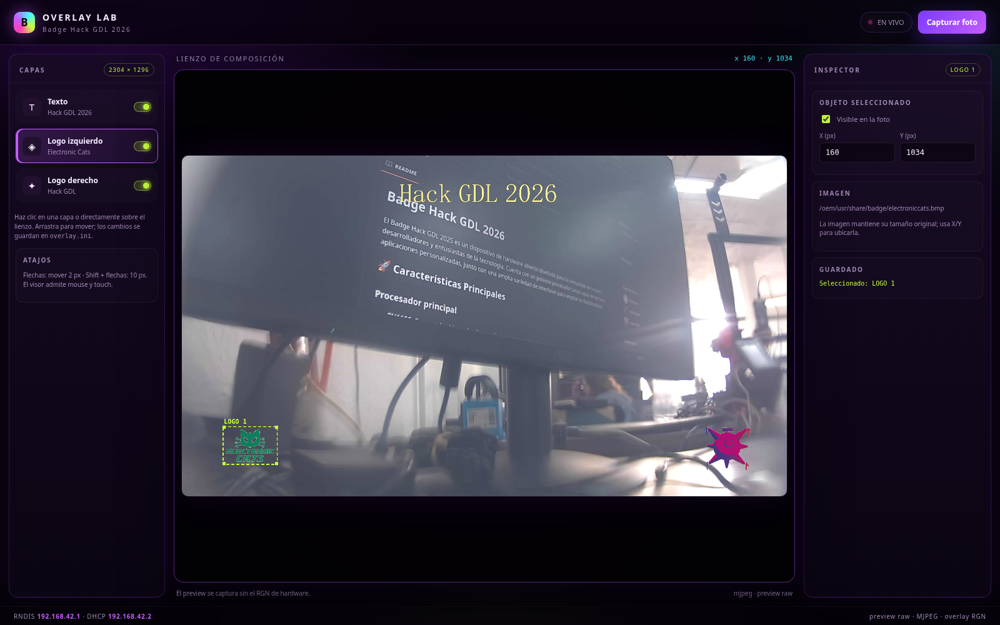

# Badge Hack GDL 2026

El Badge Hack GDL 2026 es un dispositivo de hardware abierto diseñado para la
comunidad de hackers, desarrolladores y entusiastas de la tecnología. Integra
un procesador Linux RV1106 con cámara, LED RGB, botones y USB-C, y un firmware
propio con captura de fotos, MTP, ADB y un editor visual de overlay.

## 🚀 Características Principales

### Procesador principal

- **RV1106G3**: procesador Linux de alto rendimiento
  - ARM Cortex-A7 + MCU RISC-V
  - NPU integrada
  - ISP integrado
  - Soporte completo para Linux

### Interfaces y Conectividad

- **GPIOs**: pines de propósito general
- **MIPI CSI**: cámara SC3336 de 3 MP
- **UART**: consola serial de depuración
- **USB-C**: datos y alimentación (MTP, ADB y RNDIS)

### Periféricos Integrados

- **NeoPixel**: LED RGB WS2812E por SPI
- **Batería**: soporte para 18650 con gestión de energía
- **Buck Converter**: regulación DC-DC
- **Cámara**: SC3336, 2304×1296
- **Botones**: 5 botones `gpio-keys`

## 📦 Componentes del Proyecto

El proyecto está dividido en tres bloques:

### 1. Badge Principal (`hardware/`)

Incluye el diseño principal:

- Procesador RV1106G3
- LED NeoPixel WS2812E
- Gestión de energía y batería
- Interfaz MIPI para la cámara
- USB-C y botones

### 2. Firmware (`luckfox-pico`)

La capa de firmware vive en la rama `badge_hackgdl_2026_v2` del
repositorio [`ElectronicCats/luckfox-pico`](https://github.com/ElectronicCats/luckfox-pico).
Incluye:

- `badge_photo`: captura, AIQ/ISP, overlay, motor RGB y botones;
- `overlay_web`: editor visual y streaming MJPEG;
- `rndis_dhcp`: red USB y DHCP;
- MTP/ADB sobre FunctionFS con uMTP-Responder;
- board config, DTS, kernel fragment, MCU y overlay;
- scripts de build, flasheo y pruebas.

### 3. Add-ons (`Add-ons/`)

Diseños y firmware de los add-ons Pescadito y Tortuguita.

## 📋 Especificaciones Técnicas

| Componente | Especificación |
|---|---|
| Procesador | RV1106G3 (ARM Cortex-A7 + RISC-V MCU + NPU + ISP) |
| Sistema Operativo | Linux (BusyBox) |
| Cámara | SC3336, 2304×1296, MIPI CSI-2 |
| LED | WS2812E NeoPixel por SPI0 |
| Batería | 18650 |
| USB | USB-C: MTP + ADB + RNDIS |
| Botones | 5 `gpio-keys` |
| Almacenamiento | SPI NAND 256 MB, `/userdata` UBIFS |

## 🔌 Interfaces del RV1106

### Comunicación

- **UART**: consola serial de depuración
- **SPI**: LED WS2812 y periféricos
- **I2C**: cámara y sensores
- **USB**: MTP, ADB y RNDIS

### Multimedia e Imagen

- **MIPI CSI**: cámara SC3336
- **ISP**: procesamiento de imagen integrado
- **VENC**: JPEG y MJPEG para fotos y editor

### Control

- **GPIOs**: botones, LED y señales de la cámara
- **PWM**: disponible para periféricos

---

## **Primeros pasos**

El badge está basado en el hardware y el SDK de la Luckfox Pico Pro Max. Para
detalles de la plataforma puedes consultar la
[Wiki oficial de Luckfox](https://wiki.luckfox.com/Luckfox-Pico-Pro-Max/).

En esta sección aprenderás a:

- encender y usar tu badge;
- tomar fotografías;
- copiar las imágenes a tu computadora;
- personalizar el overlay de las fotos;
- abrir el editor web.

### **1. Alimentar tu badge**

Puedes alimentar la badge de dos maneras:

- con una batería **18650** en el compartimento trasero;
- por **USB-C** desde una computadora o cargador.


Respeta la polaridad marcada en el portapilas. El USB-C también transporta
MTP, ADB y RNDIS.

### **2. Encender el badge**

El interruptor **OFF/ON** está en el lado derecho de la placa.

1. Conecta la batería y/o el USB-C.
2. Coloca el interruptor en **ON**.
3. Espera el **doble destello verde** del NeoPixel.


El arranque es **cámara-first**: la aplicación inicia la cámara y el LED, y
sólo cuando la cámara está lista expone MTP, ADB y la web. En el arranque real
esto tarda aproximadamente **25–30 segundos**. Es normal que durante ese tiempo
la badge todavía no aparezca en la computadora.

### **3. Botones**


| Botón | `gpio-keys` | Función por defecto |
|---|---|---|
| Superior | `KEY_ENTER` | Tomar foto |
| USER1 (arriba) | `KEY_UP` | Acción de usuario programable |
| USER2 | `KEY_RIGHT` | Acción de usuario programable |
| USER3 | `KEY_LEFT` | Siguiente rutina RGB |
| USER4 (abajo) | `KEY_DOWN` | Rutina RGB anterior |

USER1 y USER2 están libres para que agregues tus propias acciones en
`badge/app/src/user_led.c`.

### **Blink Blink!**

Presiona **USER3** y **USER4** para recorrer las rutinas del NeoPixel:

1. `Off`
2. `Breath`
3. `Rainbow`
4. `Pulse`
5. `Alert`
6. `Candle`

Al arrancar, el LED hace dos destellos verdes y luego queda en `Off` hasta que
selecciones una rutina.

### **📸 Tomar fotografías**

Con la badge encendida y la cámara lista, presiona el **botón superior**.


Al capturar:

- el NeoPixel hace un destello blanco;
- la foto se guarda en `/userdata/photos`;
- el JPEG aparece por MTP en **Badge Hack GDL 2026 Photos**.

La foto final es de **2304×1296**, con giro de 180° y el overlay configurado.
El nombre usa la fecha y hora del sistema; como la badge no tiene RTC con
batería, es normal ver nombres como `IMG_19700101_000611_0000.jpg`.

### **💾 Extraer fotografías**

Las imágenes se transfieren por **MTP**. Conecta la badge por USB-C y espera a
que termine el arranque de la cámara.

**Windows**

1. Abre **Este equipo**.
2. Entra a **Badge Hack GDL 2026**.
3. Abre **Badge Hack GDL 2026 Photos**.
4. Copia los archivos `IMG_*.jpg`.
5. Usa **Quitar hardware de forma segura** antes de desconectar.


**Linux (GNOME/gvfs)**

1. Conecta la badge.
2. Abre el gestor de archivos; aparece como **Badge Hack GDL 2026**.
3. Entra a **Badge Hack GDL 2026 Photos**.


También puedes usar la terminal:

```bash
gio mount mtp://
gio list 'mtp://Electronic_Cats_Badge_Hack_GDL_2026_<serial>/Badge Hack GDL 2026 Photos'
```

**macOS:** instala **OpenMTP** o **Android File Transfer** y abre el
dispositivo. La carpeta de fotos tiene el mismo nombre.

La carpeta **Badge Config** contiene `overlay.ini`, la configuración del
overlay. Puedes copiarla, editarla en tu computadora y volver a copiarla; la
app y el editor la detectan automáticamente.

> En Windows, algunos clientes MTP no permiten editar un archivo “en sitio”.
> Si falla, copia `overlay.ini` al escritorio, edítalo y cópialo de vuelta a
> **Badge Config**. También puedes usar el editor web.

### **⚙ Archivo `overlay.ini`**

`overlay.ini` define el texto y los dos logos que se dibujan sobre la foto.
Ejemplo con los valores por defecto:

```ini
[logo1]
enabled = 1
x = 160
y = 1034
image = /oem/usr/share/badge/electroniccats.bmp

[logo2]
enabled = 1
x = 1976
y = 1024
image = /oem/usr/share/badge/hack_gdl.bmp

[text]
enabled = 1
x = 828
y = 92
text = Hack GDL 2026
size = 100
color = fff799
font = /oem/usr/share/badge/font.ttf
```

- `enabled`: `1` muestra el elemento, `0` lo oculta.
- `x`, `y`: posición en píxeles. El RGN del RV1106 exige coordenadas **pares**;
  la app y el editor las normalizan.
- `image`: ruta del BMP dentro de la imagen.
- `text`, `size`, `color`, `font`: texto, tamaño, color RGB hexadecimal y
  fuente del OSD.

Los cambios se aplican a la siguiente foto. Puedes editar el archivo por MTP o
usar el editor web; ambos escriben el mismo `overlay.ini`.

### **🖼 Editor web**

Con la badge conectada por USB, la computadora obtiene una interfaz de red USB
(RNDIS) con IP `192.168.42.2`. Abre:

```text
http://192.168.42.1/
```



El editor permite:

- arrastrar los dos logos y el texto sobre la vista de la cámara;
- cambiar texto, tamaño, color, visibilidad y posición X/Y;
- ver el stream MJPEG en vivo;
- capturar una foto con **Capturar foto**;
- editar `overlay.ini` sin botón de guardar: el autoguardado escribe el archivo;
- ver cambios hechos por MTP sin recargar la página (sincronización en ambos
  sentidos).

Si la página no abre, espera a que termine el arranque de la cámara y revisa
que el adaptador RNDIS tenga IP. Si no hay DHCP, asigna manualmente
`192.168.42.2/24`.

---

# **🚀 ¿Te interesa saber más sobre cómo se programó todo esto?**

El firmware se organiza en una capa limpia dentro de `luckfox-pico`:

- `badge/app/src/main.c`: arranque cámara-first, botones y ciclo principal;
- `badge/app/src/camera.c`: pipeline VI/VENC y captura JPEG;
- `badge/app/src/aiq.c`: carga de AIQ y calibración del ISP;
- `badge/app/src/overlay.c`: overlay RGN (logos y texto);
- `badge/app/src/led_engine.c` y `user_led.c`: motor y rutinas RGB;
- `badge/app/src/overlay_web.c`: servidor del editor y streaming;
- `badge/configs/overlay-badge-fastboot/etc/init.d/S49mtp`: gadget USB;
- `badge/scripts/`: build, flasheo y pruebas.

La documentación de build y flasheo está en el
[README de la capa](https://github.com/ElectronicCats/luckfox-pico/blob/badge_hackgdl_2026_v2/badge/README.md).

---

## 🔌 Conectarse al puerto serial (Debug Serial)

Para ver logs o depurar, conecta un adaptador USB-UART de **3.3 V** al puerto
DEBUG SERIAL. Corresponde a la UART2 del RV1106:


```text
TX del adaptador → RX del badge (GPIO1_B3)
RX del adaptador → TX del badge (GPIO1_B2)
GND → GND
```

> La señal es **3.3 V TTL**. No uses adaptadores de 5 V sin nivelador.

## ✔ Adaptadores USB–Serial compatibles

Puedes usar cualquier adaptador USB-UART de 3.3 V, por ejemplo:

- CH340 / CH341
- CP2102 / CP2104
- FT232RL
- PL2303
- CP2105
- Matek F405

## 💻 Cómo abrir la terminal serial

### 🐧 Linux

```bash
dmesg | grep tty
screen /dev/ttyUSB0 115200
# o:
sudo minicom -b 115200 -D /dev/ttyUSB0
```

Para salir de `screen`: `CTRL+A`, luego `K`.

### 🍎 macOS

```bash
ls /dev/tty.*
screen /dev/tty.usbserial-XXXX 115200
```

Para salir: `CTRL+A`, luego `K`. También puedes usar CoolTerm.

### 🪟 Windows

Usa PuTTY, TeraTerm, CoolTerm o RealTerm. En el Administrador de dispositivos
identifica el puerto COM y configura:

```text
Baudrate: 115200
Data bits: 8
Parity: None
Stop bits: 1
Flow control: None
```

---

### **Comunicación ADB**

ADB está habilitado en la imagen. Se expone después del arranque de la cámara
(~25–30 s).

1. Conecta la badge por USB-C.
2. Ejecuta:

```bash
adb devices
adb shell
```

El shell entra como **root**. ADB forma parte de las Android Platform Tools:

```text
https://developer.android.com/studio/releases/platform-tools
```

En Linux también puedes instalarlo con:

```bash
sudo apt update
sudo apt install android-tools-adb
```

---

## 🛠 Compilar el firmware

### Requisitos

- Linux x86_64 (probado en Ubuntu).
- Git, make, gcc/g++, bc, cpio, rsync, fakeroot, dtc, mkimage, python3, scons.
- ~25 GB libres para el SDK y los artefactos.
- Para flashear: `upgrade_tool` y acceso USB a la badge.

### Clonar y compilar

```bash
git clone -b badge_hackgdl_2026_v2 --single-branch \
  https://github.com/ElectronicCats/luckfox-pico.git
cd luckfox-pico
./badge/build.sh all
```

La primera compilación crea un worktree del SDK en `badge/build/luckfox-pico`,
descarga el toolchain RISC-V del HPMCU (~550 MB) y compila la imagen. Las
compilaciones siguientes reutilizan el worktree.

Si faltan `bison`, `flex`, `m4` o `python`, instálalos sin sudo:

```bash
./badge/scripts/install-host-tools.sh
```

Etapas disponibles:

```text
media, uboot, kernel, rootfs, app, pack, firmware, clean
```

Resultado:

```text
badge/out/update.img
```

El empaquetador de Rockchip incluye la hora de compilación en `update.img`, por
lo que un rebuild limpio no es byte-idéntico a la imagen de release. La imagen
validada de esta versión tiene:

```text
SHA256 21a1dc67597e43aa473b774031d7ca5f01394b59c68c1778c478361bb57895eb
```

La imagen validada se publicará en la sección **Releases** del repositorio; el
binario no se versiona en Git.

---

## 🌳 Device Tree y botones

La capa incluye el DTS `rv1106g-badge-fastboot.dts`; no necesitas editar el
árbol de Luckfox a mano. Los botones se exponen como `gpio-keys`:

| Botón | GPIO | Código Linux | Función |
|---|---|---|---|
| Superior | `GPIO1_D3` | `KEY_ENTER` | Captura |
| USER1 | `GPIO2_B1` | `KEY_UP` | Libre |
| USER2 | `GPIO2_B0` | `KEY_RIGHT` | Libre |
| USER3 | `GPIO2_A7` | `KEY_LEFT` | Siguiente rutina |
| USER4 | `GPIO2_A6` | `KEY_DOWN` | Rutina anterior |

El DTS también configura:

- cámara SC3336 en I2C4 (`0x30`) y MIPI CSI-2 de 2 lanes;
- LED WS2812 en SPI0 (`/dev/spidev0.0`);
- USB en modo `peripheral`;
- eliminación de `fbtft` y `mis5001` para evitar conflictos.

Puedes leer los eventos desde `/dev/input/eventX` en C o Python.

---

## 💡 NeoPixel y rutinas RGB

El motor está en `badge/app/src/led_engine.c`:

- no usa hilos, `sleep()` ni `malloc()`;
- llama a cada rutina cada ~20 ms;
- la rutina llena tres bytes (`R`, `G`, `B`) y regresa;
- el motor escribe el WS2812 por SPI a 2.4 MHz.

Para agregar una rutina, edita `badge/app/src/user_led.c`:

```c
static void my_routine(uint32_t elapsed_ms, uint8_t *rgb)
{
    uint8_t blink = ((elapsed_ms / 250) & 1) ? 255 : 0;

    rgb[0] = blink;      /* R */
    rgb[1] = 0;          /* G */
    rgb[2] = blink / 2;  /* B */
}

const led_pattern_t user_led_patterns[] = {
    { "USER demo", user_demo_frame },
    { "Mi rutina", my_routine },
};
```

USER3/USER4 recorren la lista; USER1/USER2 llaman a los hooks
`user_led_on_button_up()` y `user_led_on_button_right()`. No bloquees la rutina
ni escribas directamente en `/dev/spidev0.0`.

---

## 📸 Captura de fotografías

La captura la realiza `badge_photo`:

- inicia AIQ/ISP antes de abrir la cámara;
- espera un frame de warmup y reinicia el pipeline si hace falta;
- usa VENC 0 (JPEG q=90) para la foto final;
- usa VENC 1 (JPEG q=55, sin RGN) para el preview del editor;
- aplica giro de 180° y el overlay RGN;
- escribe el JPEG en `/userdata/.badge_photo_staging` y lo renombra a
  `/userdata/photos`.

El botón superior dispara la captura; el LED hace un destello blanco. La app
sigue viva si una captura falla y reintenta.

---

## 💾 MTP y configuración

`S49mtp` crea un gadget USB con:

- **MTP** por FunctionFS (`umtprd`);
- **ADB** por FunctionFS;
- **RNDIS** para la red USB.

El orden de arranque es:

```text
rcS → badge_photo → /tmp/badge_system.ready → S49mtp → MTP/ADB/RNDIS
```

MTP expone:

| Carpeta | Contenido |
|---|---|
| `Badge Hack GDL 2026 Photos` | Fotos `IMG_*.jpg` |
| `Badge Config` | `overlay.ini` |

No se expone `/userdata` completo ni el rootfs. El archivo `overlay.ini` se
publica en modo `0666` para que los clientes MTP puedan sobrescribirlo.

### Editar `overlay.ini` por MTP

1. Copia `overlay.ini` de **Badge Config** a tu computadora.
2. Edítalo con un editor de texto.
3. Cópialo de vuelta a **Badge Config**.
4. La app aplica el cambio en la siguiente foto; si el editor web está abierto,
   lo refleja sin F5.

En Windows, si el cliente MTP no permite sobrescribir en sitio, usa
copiar/editar/copiar o el editor web.

### Sincronización MTP ↔ editor

El editor consulta `/overlay.ini` cada segundo. Aplica cambios externos cuando:

- el archivo tiene las secciones `logo1`, `logo2` y `text`;
- el contenido se mantiene estable 700 ms;
- no hay un arrastre, un input enfocado o un autoguardado en curso.

En la dirección editor → MTP, el autoguardado escribe el archivo y actualiza su
referencia para evitar bucles.

---

## 🚀 Arranque del sistema

El firmware usa System V init con un `rcS` propio:

1. monta `/userdata` y `/dev/pts`;
2. inicia `badge_photo` en un bucle de supervisión;
3. espera `/tmp/badge_system.ready` (timeout de 35 s);
4. arranca `S49mtp` (MTP + ADB + RNDIS);
5. expone la web en `http://192.168.42.1/`.

Los scripts `S49mtp` y `rcS` están en
`badge/configs/overlay-badge-fastboot/`.

### Reconexión USB

Si desconectas y vuelves a conectar el USB con la badge encendida, `S49mtp`
reengancha el gadget automáticamente; no hace falta cortar la alimentación de
la batería. El watchdog registra los eventos en
`/userdata/badge/usb_watchdog.log`.

---

## 🖼️ Overlay de la imagen

El overlay de rootfs está en:

```text
badge/configs/overlay-badge-fastboot/
```

Incluye:

- `etc/init.d/S49mtp`, `etc/fstab`, `etc/inittab` y `etc/umtprd/`;
- `oem/usr/share/badge/` con `overlay.ini`, logos, fuente y `editor.html`;
- módulos USB (`u_ether.ko`, `usb_f_rndis.ko`).

El build copia este overlay a la imagen final.

---

# Cargar la imagen

Descarga la imagen validada desde la sección **Releases** del repositorio
`badge_hackgdl_2026`. Si compilaste localmente, usa `badge/out/update.img`.

## Windows

1. Descarga `upgrade_tool` desde la
   [Wiki de Luckfox](https://wiki.luckfox.com/Luckfox-Pico-Pro-Max/Flash-image).
2. Conecta la badge con **BOOT** presionado para entrar en maskrom.
3. Flashea con `upgrade_tool UF` y el archivo `.img`.

## Linux

Si compilaste localmente:

```bash
sudo ./badge/scripts/flash.sh badge/out/update.img
```

Si descargaste la imagen:

```bash
sudo upgrade_tool UF /ruta/al/archivo.img
```

Para entrar a maskrom:

1. Mantén presionado **BOOT**.
2. Pulsa y suelta **RST**.
3. Sigue sosteniendo **BOOT** ~5 s hasta que el host detecte `2207:110c` o
   `2207:350a`.
4. Suelta **BOOT**.

> Usa siempre `UF`; `DI -b` no es fiable en esta SPI NAND.

Si la badge ya está en Linux con ADB:

```bash
./badge/scripts/maskrom.sh
```

## macOS

1. Descarga `upgrade_tool` para macOS desde la Wiki de Luckfox.
2. Entra a maskrom con **BOOT+RST**.
3. Ejecuta `upgrade_tool UF` con la imagen.

---

## 📖 Documentación Adicional

- [Capa de firmware y build](https://github.com/ElectronicCats/luckfox-pico/blob/badge_hackgdl_2026_v2/badge/README.md)
- [Wiki de Luckfox Pico](https://wiki.luckfox.com/Luckfox-Pico-RV1106)
- [Datasheet RV1106](https://files.luckfox.com/wiki/Luckfox-Pico/PDF/Rockchip%20RV1106%20Datasheet%20V1.7-20231218.pdf)
- [KiCad Documentation](https://docs.kicad.org/)

## 🤝 Contribuciones

Este es un proyecto de hardware abierto. Las contribuciones son bienvenidas:

1. Haz un fork del repositorio.
2. Crea una rama para tu feature (`git checkout -b feature/AmazingFeature`).
3. Haz commit de tus cambios (`git commit -m 'Add some AmazingFeature'`).
4. Haz push a tu rama (`git push origin feature/AmazingFeature`).
5. Abre un Pull Request.

## 📝 Licencia

Este proyecto es de hardware abierto. Consulta los archivos de licencia para
más detalles.

## 🏢 Electronic Cats

Desarrollado con ❤️ por [Electronic Cats](https://www.electroniccats.com/).

<a href="https://github.com/sponsors/ElectronicCats">

</a>

Electronic Cats invierte tiempo y recursos en proporcionar este diseño de
hardware abierto. Por favor, apoya a Electronic Cats y al hardware abierto
comprando productos de Electronic Cats.

## 📞 Contacto y soporte

- **Website**: [https://www.electroniccats.com/](https://www.electroniccats.com/)
- **GitHub**: [ElectronicCats](https://github.com/ElectronicCats)
- **Issues**: usa la sección de Issues del repositorio.

## 🙏 Agradecimientos

Gracias a toda la comunidad de hardware abierto y a todas las personas que
hacen posibles proyectos como este.
